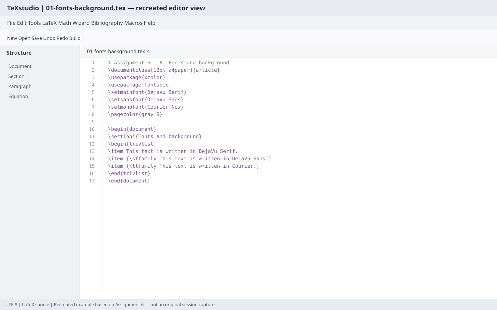
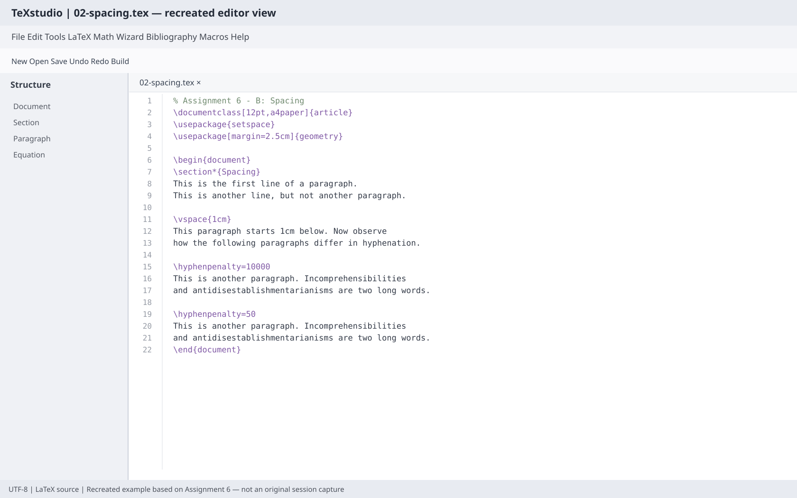
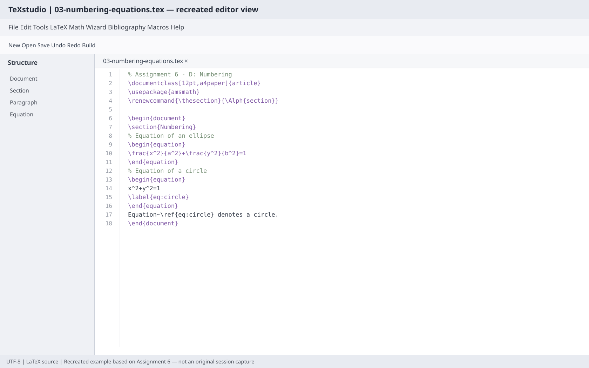
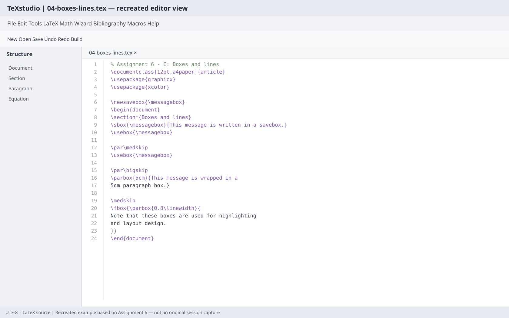
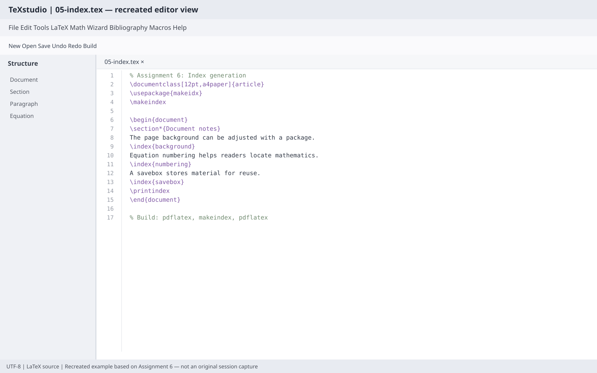
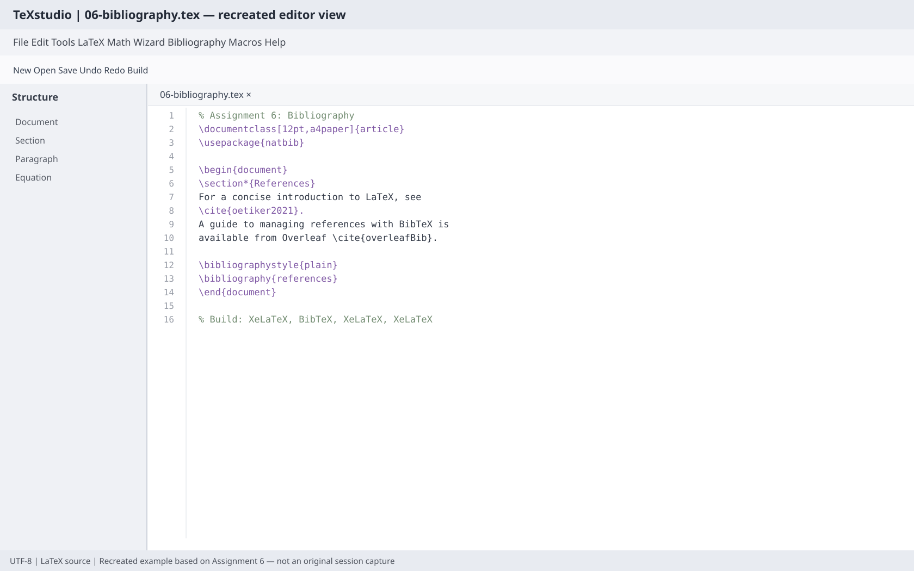

# Assignment 6 — LaTeX practical screenshots

These editor-style images are recreated illustrations based on the topics in Assignment 6. They are **not original screenshots captured during a TeXstudio lab session**.

| Topic | TeXstudio-style editor view |
|---|---|
| Fonts and background |  |
| Paragraph spacing and hyphenation |  |
| Alphabetic numbering and equations |  |
| Boxes and lines |  |
| Index generation |  |
| Bibliography and citations |  |

Editable LaTeX examples are maintained separately in the repository's LaTeX examples folder. Open and compile them in TeXstudio to inspect the source and output.
